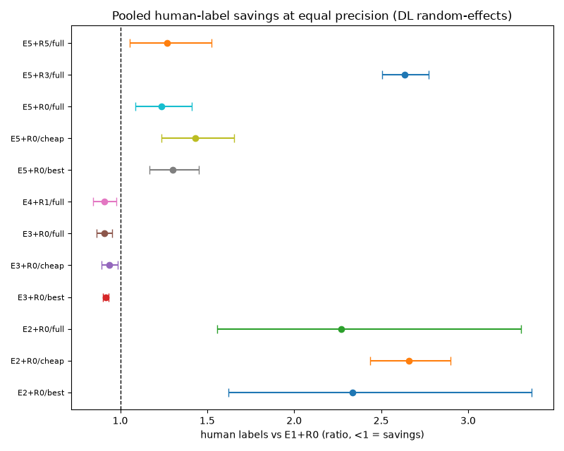

# FewHumans

Combine **few human labels** with **many LLM-judge labels** and still report an
**unbiased estimate with a valid confidence interval** — plus which items humans
should label next, and when to stop.

## Install

```
pip install fewhumans
```

(Contributors: `pip install -e ".[dev]"` for tests and linters.)



Pre-registered study, 7 real annotation tasks, 3-judge panel (2 local + 1 API):

| method | human labels vs human-only |
|---|---|
| PPI++ (E3) | **0.91 [0.87, 0.95]** |
| Stratified PPI++ (E4) | **0.91 [0.84, 0.98]** |
| Active IPW, uniform (E5+R0) | 1.24 (costs more) |
| Fixed PPI (E2) | 2.27× (never reaches target on 4/7) |
| Disagreement routing (E5+R3) | 2.64× (never reaches target on 5/7) |

Judge-only intervals missed the full-human value in **18/21** panels.
Verbalized confidence is overconfident everywhere (ECE up to 0.98).
Full evidence note: `results/study_report.md`.

## 20-line quick start

```python
import fewhumans as fh

task = fh.Task(label_space=fh.Categorical(["correct", "incorrect"]),
               estimand=fh.Mean(of=lambda y: y == "correct"))
panel = fh.Panel([fh.FakeJudge("fake", accuracy=0.8, seed=0)])
s = fh.Session.create("runs/my_eval", items=items, task=task, panel=panel,
                      routing=fh.routing.Uniform(budget=300), confidence=0.95)
s.run_panel()
for item in s.queue(n=20):
    s.add_human(item.item_id, label=truth[item.item_id], annotator="raihan")
est = s.estimate("E3-ppi-plus")
print(est)  # value [lo, hi] (E3-ppi-plus, 20 human labels, 95% CI)
s.report("report.html")  # judge report card
```

## Which estimator when

| situation | use | why |
|---|---|---|
| Default: uniform humans, decent judge | **E3 PPI++** | saved ~9% of labels on all 7 study tasks |
| Panel agrees on most items | **E4 stratified** | same savings, simpler assumptions (needs n≥100) |
| Heavy-tailed truth (scores with outliers) | **E5 active** or n≥200 | only method that held everywhere on wmt-mqm |
| Just start labeling, no judge yet | **E1 human-only** | always valid; the baseline everything beats (or not) |
| Quick sanity number | E0 judge-only | NEVER report it — it missed truth 18/21 times here |
| Fixed PPI (λ=1) / disagreement routing | avoid | cost 2.3×/2.6× with mediocre judges in our study |

Validated ranges: `results/coverage_report.md`. Worked examples: `examples/`.

## CLI

```
fewhumans init runs/x --items items.jsonl
fewhumans judge runs/x
fewhumans queue runs/x --n 20 > to_label.jsonl   # or: fewhumans label runs/x
fewhumans add runs/x labels.jsonl
fewhumans estimate runs/x
fewhumans report runs/x --html report.html
```

## What this does not show

- Savings are ~9%, not 10×: judges here are mediocre (agreement 45–77%).
  Stronger judges would save more — and the gate would need re-running.
- E4 needs n≥100; skewed truth (wmt-mqm) needs n≥200 for E1–E4.
  Validated ranges: `results/coverage_report.md`.
- Ratio estimands (F1), sequential PPI++/active bounds: not shipped
  (behind `experimental=True` until a gate validates them).
- 7 English-heavy tasks, 3 mid-tier judges, one run each ($0.29 API spend).

## Reproduce

```
pip install -e ".[dev]"   # contributors
pytest -q                                   # 49 tests
python examples/quickstart_accuracy.py      # accuracy from judges + 50 humans
python examples/pairwise_winrate.py         # win rate with disagreement routing
python examples/toy_end_to_end.py
python study/analyze/study.py               # needs results/study_parts/
```

Paper (draft): `paper/main.tex`. JudgeBank: `data/release/judgebank/` (+ datasheet).
Plan: `docs/PLAN.md`. Rules: `CLAUDE.md`. Decisions: `docs/decisions.md`.
